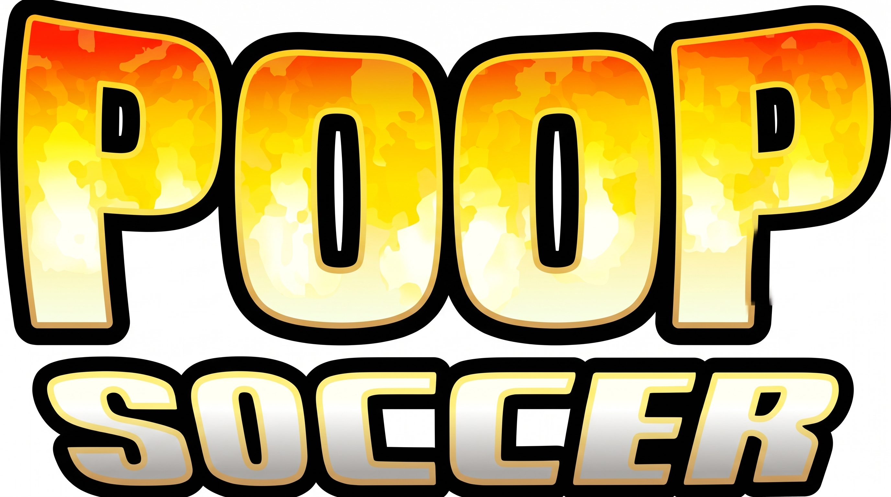
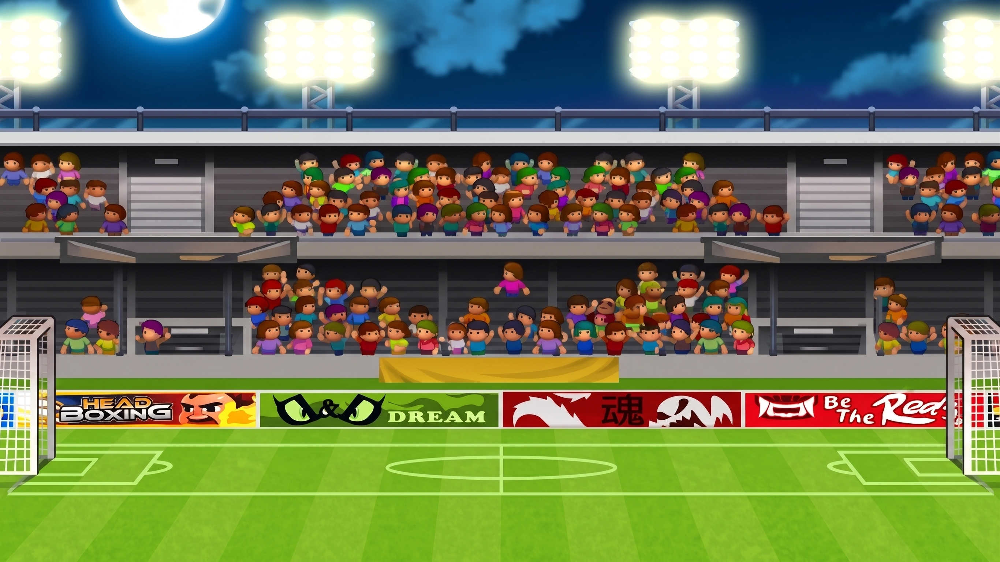
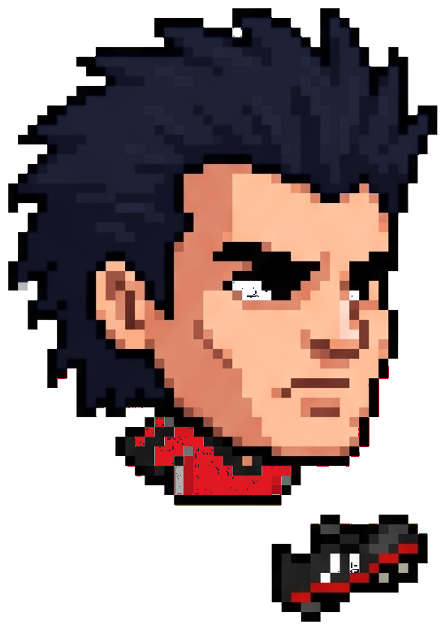
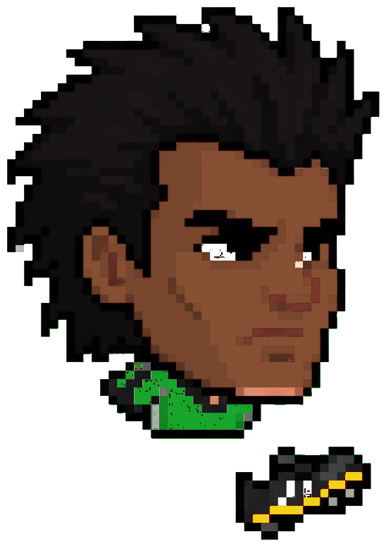
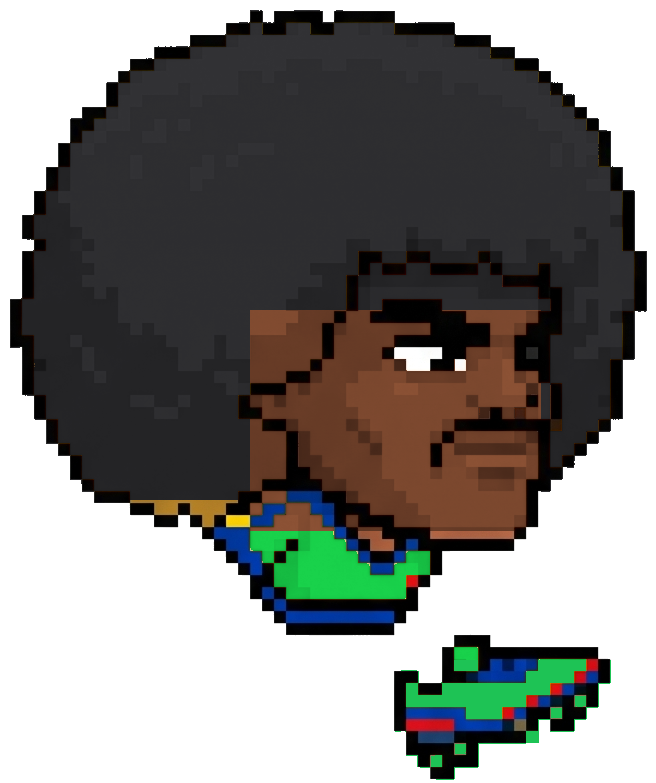
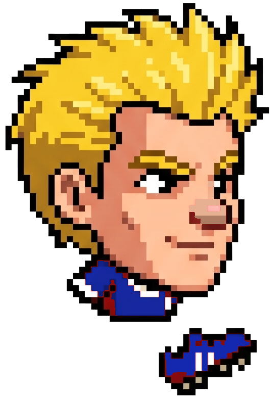
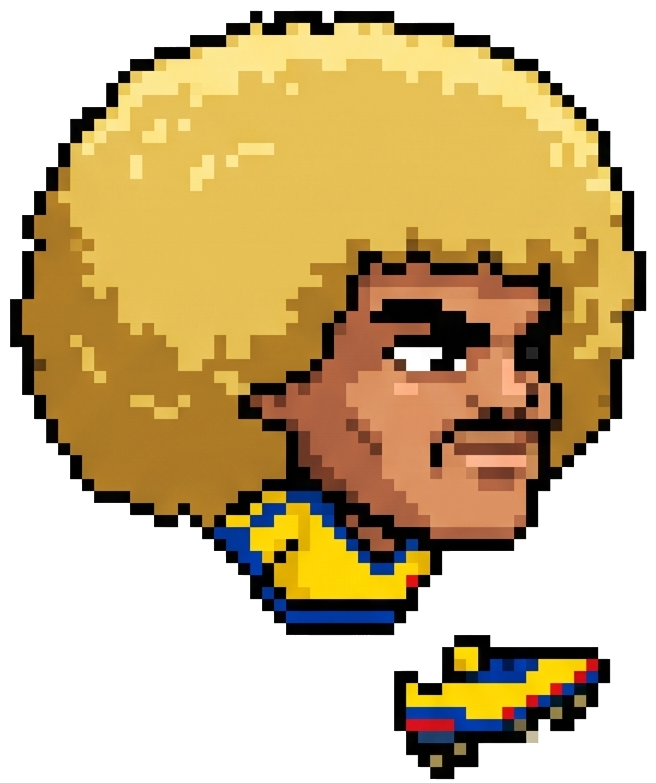
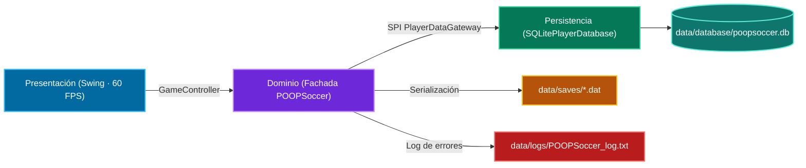

<div align="center">

# ⚽ POOPSoccer (DOPOSoccer)
### *El Head Soccer Académico — Fútbol Arcade 2D, Poderes Únicos y Progresión en SQLite*



<p>
  
  
  
  
  
</p>

<p>
  <a href="#1-qu%C3%A9-es-poopsoccer">🎯 ¿Qué es?</a> &nbsp;•&nbsp;
  <a href="#2-controles-personajes-poderes-y-estad%C3%ADsticas">🎮 Controles y Poderes</a> &nbsp;•&nbsp;
  <a href="#3-arquitectura-y-ejecuci%C3%B3n">🏗️ Arquitectura</a> &nbsp;•&nbsp;
  <a href="#4-matriz-de-cobertura-de-requisitos-funcionales-rf-01-a-rf-13">📋 Requisitos (RF)</a> &nbsp;•&nbsp;
  <a href="#5-historia-y-pruebas-de-aceptaci%C3%B3n-el-especial-de-samuel-y-juan-pop-soccer">🎬 Pruebas de Aceptación</a> &nbsp;•&nbsp;
  <a href="#6-derechos-de-autor-y-referencias">©️ Derechos de Autor</a>
</p>

</div>

> [!NOTE]
> **Proyecto Final 2026-2 — Desarrollo Orientado por Objetos (Escuela Colombiana de Ingeniería Julio Garavito)**
> Adaptación de escritorio de *Head Soccer* en 2D con partidos locales en el mismo teclado, tiros de poder únicos por país, inteligencia artificial, progresión persistente de estadísticas en SQLite y guardado/carga de partidas.

---

## Tabla de Contenidos

1. [¿Qué es POOPSoccer?](#1-qu%C3%A9-es-poopsoccer)
2. [Controles, Personajes, Poderes y Estadísticas](#2-controles-personajes-poderes-y-estad%C3%ADsticas)
3. [Arquitectura y Ejecución](#3-arquitectura-y-ejecuci%C3%B3n)
4. [Matriz de Cobertura de Requisitos Funcionales (RF-01 a RF-13)](#4-matriz-de-cobertura-de-requisitos-funcionales-rf-01-a-rf-13)
5. [Historia y Pruebas de Aceptación: El Especial de Samuel y Juan (*"Pop Soccer"*)](#5-historia-y-pruebas-de-aceptaci%C3%B3n-el-especial-de-samuel-y-juan-pop-soccer)
   - [Acto I — Samuel contra la Máquina: Configuración, Errores, MvM y PvM (Video 1)](#acto-i--samuel-contra-la-m%C3%A1quina-configuraci%C3%B3n-errores-mvm-y-pvm)
   - [Acto II — Juan contra la Máquina (Parte 1): Tornado, Ilusión, Aturdimiento y Pausa (Video 2)](#acto-ii--juan-contra-la-m%C3%A1quina-parte-1-tornado-ilusi%C3%B3n-aturdimiento-y-pausa)
   - [Acto III — Juan contra la Máquina (Parte 2): Persistencia SQLite, Mejoras y Guardar/Abrir (Video 3)](#acto-iii--juan-contra-la-m%C3%A1quina-parte-2-persistencia-sqlite-mejoras-y-guardarabrir)
   - [Acto IV — Samuel vs. Juan: El Encuentro PvP, Partido por Tiempo y Muerte Súbita (Video 4)](#acto-iv--samuel-vs-juan-el-encuentro-pvp-partido-por-tiempo-y-muerte-s%C3%BAbita)
   - [Acto V — Samuel vs. Juan: La Gran Final, Partida Guardada, Premiación y Cierre (Video 5)](#acto-v--samuel-vs-juan-la-gran-final-partida-guardada-premiaci%C3%B3n-y-cierre)
6. [Derechos de Autor y Referencias](#6-derechos-de-autor-y-referencias)

---

## 1. ¿Qué es POOPSoccer?

**POOPSoccer** (también referenciado en la documentación del curso como **DOPOSoccer**, y rebautizado con cariño como *"Pop Soccer"* por quienes lo prueban por primera vez) lleva la frenética esencia arcade de *Head Soccer* (D&D Dream, 2012) del celular al computador:

| Característica | Detalle en el juego |
| :--- | :--- |
| 🕹️ **Tres modalidades** | `Jugador vs Jugador (PvP)` en el mismo teclado, `Jugador vs Máquina (PvM)` y `Máquina vs Máquina (MvM)`. |
| ⏱️ **Dos tipos de partido** | `Por goles` (meta de `3`, `5` o `7` goles) y `Por tiempo` (`1`, `2`, `3` o `5` min, con **`¡MUERTE SÚBITA!`** si empatan al llegar a `0s`). |
| 🖥️ **Tres resoluciones** | `Pequeña (1/4 de pantalla)`, `Mediana (1/2 de pantalla)` y `Grande (3/4 de pantalla)`, escalando la cancha (`800×600` lógico) y el `InfoPanel`. |
| 💥 **Combate y aturdimiento** | Patadas cuerpo a cuerpo y tiros de poder reducen la vida del rival; al llegar a `0`, queda **`¡ATURDIDO!`** por `3 s` antes de recuperar su vida máxima. |
| 💾 **Persistencia dual** | Progreso e historial (`Puntos`, `PJ`, `G`) en SQLite (`data/database/poopsoccer.db`) y partidas portables en `.dat` (`data/saves/`). |

<div align="center">
  
  <br/>
  <sub><em>Estadio oficial de POOPSoccer (cancha lógica 800×600 escalable en 3 resoluciones a 60 FPS).</em></sub>
</div>

---

## 2. Controles, Personajes, Poderes y Estadísticas

### ⌨️ Controles en el mismo teclado

| Acción | 🟦 Jugador 1 (Izquierda) | 🟧 Jugador 2 (Derecha) |
| :--- | :---: | :---: |
| **Mover a la izquierda** | <kbd>A</kbd> | <kbd>←</kbd> |
| **Mover a la derecha** | <kbd>D</kbd> | <kbd>→</kbd> |
| **Saltar** | <kbd>W</kbd> | <kbd>↑</kbd> |
| **Patear** | <kbd>S</kbd> | <kbd>↓</kbd> |
| **Activar Poder** | <kbd>Q</kbd> | <kbd>Ctrl</kbd> *(Derecho)* |
| **Pausar Partido** | <kbd>Esc</kbd> *(compartido)* | <kbd>Esc</kbd> *(compartido)* |

### 🌍 Selecciones y Tiros de Poder

La barra de poder se llena en **`10` segundos** (y recibe un impulso instantáneo del **`+25%`** cada vez que el jugador concede un gol). Al presionar la tecla de poder con la barra llena (`100%`), el personaje obtiene un aura dorada/celeste y lanza su tiro especial al tocar el balón:

| Sprite | País | Tiro de Poder | Comportamiento del Disparo | Efecto al Rival | Duración | Daño (`DañoTiro`) |
| :---: | :--- | :--- | :--- | :--- | :---: | :---: |
|  | 🇰🇷 **Corea del Sur** |  | Disparo recto y horizontal a máxima velocidad (`16 px/frame`), sin caída por gravedad. | `Push` — Empuja al rival hacia su propio arco. | `1.5 s` | **40** |
|  | 🇨🇲 **Camerún** |  | Disparo recto eléctrico que ignora la gravedad. | `Electrocuted` — Impide saltar y reduce velocidad al `50%`. | `3.0 s` | **60** |
|  | 🇳🇬 **Nigeria** |  | Remolino rasante que rebota rápido contra el césped. | `Unconscious` — Lanza al rival al aire e impide moverse, saltar o patear. | `3.0 s` | **40** |
|  | 🇺🇸 **Estados Unidos** |  | Divide el balón en **`8` balones idénticos** (`1` real + `7` señuelos visibles para ambos). | `Confusion` — Confunde al rival sobre cuál es el balón real. | `2.5 s` | **30** |
|  | 🇨🇴 **Colombia** *(extra)* |  | Selección adicional habilitada en el selector con el tiro de poder `Illusion`. | `Confusion` — Mismo efecto de múltiples balones. | `2.5 s` | **30** |

> [!TIP]
> **Reglas clave de poder:**
> - **Sin acumulación:** si el rival ya tiene un efecto activo, el nuevo impacto lo reemplaza.
> - **Gol limpio:** si el tiro de poder entra al arco sin tocar al rival, el gol cuenta, pero no aplica daño ni efecto.
> - **Rebote en borde o travesaño:** si el balón con tiro de poder rebota en una pared lateral o travesaño, el aura del disparo se limpia para continuar con su física normal.

### 📈 Estadísticas, HUD, Daño y Recompensas

| Estadística (`Nv. 1–10`) | Efecto por nivel (`+10%` sobre nivel `1`) | Fórmula aplicada |
| :--- | :--- | :--- |
| ⚡ **Vel** (`speed`) | Aumenta la velocidad de desplazamiento | `Velocidad = Base × (1 + 0.10 × (Nivel - 1))` |
| 🦘 **Salto** (`jump`) | Aumenta la altura del salto | `Salto = Base × (1 + 0.10 × (Nivel - 1))` |
| 💥 **Patada** (`kick`) | Multiplica daño de patadas (`10` base) y poderes | `DañoPatada = 10 × multKick` · `DañoPoder = DañoTiro × multKick` |
| ❤️ **Vida** (`life`) | Aumenta la vida máxima (`100` a `190` HP) | `VidaMax = 100 × (1 + 0.10 × (NivelVida - 1))` |

- 💰 **Costos de mejora:** Inician en `500` pts y se duplican en cada nivel (`500`, `1000`, `2000`, ... según `500 × 2^(nivel - 1)`).
- 🏆 **Puntos por partido:** **`+100` puntos** al ganador y **`+25` puntos** al perdedor.
- 🎨 **Semáforo del HUD (`InfoPanel`):** Vida `🟢 >50%` → `🟡 25%–50%` → `🔴 ≤25%` | Barra de poder `🔵 Cargando (0–10s)` → `🟡 ¡Barra llena! (100%)`.

---

## 3. Arquitectura y Ejecución



<details>
<summary>📂 <b>Ver estructura completa del proyecto</b></summary>

```text
POOPSoccer/
├── Docs/                          # Especificación oficial, diagramas (.asta) y documento técnico
├── data/
│   ├── database/poopsoccer.db     # Base de datos SQLite de perfiles, puntos e historial
│   ├── logs/POOPSoccer_log.txt    # Log de excepciones legible para desarrolladores
│   └── saves/*.dat                # Partidas guardadas mediante serialización
└── POOPSoccer/
    ├── lib/
    │   ├── Jugar_POOPSoccer.bat   # Lanzador directo en Windows (Java 17+)
    │   ├── POOPSoccer.jar         # Ejecutable empaquetado
    │   └── sqlite-jdbc-3.54.1.0.jar
    ├── resources/                 # Sprites por país, balón, arcos, estadio, menús y audio WAV
    └── src/
        ├── presentation/          # Swing UI, GamePanel (60 FPS), InfoPanel, PlayerConfig, PauseDialog, MatchSummaryDialog
        ├── domain/                # Fachada POOPSoccer, Player, Ball, Power/Effect, Machine, ProfileManager, Log
        ├── persistence/           # SQLitePlayerDatabase (registrado vía SPI en META-INF/services)
        └── test/                  # Pruebas unitarias JUnit 5 (POOPSoccerTest.java)
```

</details>

> [!IMPORTANT]
> **Cómo ejecutar en Windows:** Abre `POOPSoccer/lib/Jugar_POOPSoccer.bat` (requiere **Java 17 o superior**) o ejecuta la clase principal `presentation.POOPSoccerGUI`.

---

## 4. Matriz de Cobertura de Requisitos Funcionales (RF-01 a RF-13)

Cada requisito funcional de la especificación del proyecto (`Docs/!DOPO-FIN-2026-02.pdf`) queda cubierto y demostrado en al menos uno de los **5 videos de pruebas de aceptación**:

| Estado | Código | Requisito Funcional | Evidencia en Video(s) | Qué se verifica en pantalla |
| :---: | :--- | :--- | :---: | :--- |
| ✅ | **RF-01** | Seleccionar modalidad (`PvP`, `PvM`, `MvM`) y perfil de máquina | Video 1, Video 2, Video 4 | Botones de `MenuPanel`, selector `Perfil de máquina:` (`Torpe` activo; aviso de perfiles en construcción). |
| ✅ | **RF-02** | Seleccionar resolución de cancha al iniciar | Video 1, Video 4 | Cambio entre `Pequeña (1/4 de pantalla)`, `Mediana (1/2 de pantalla)` y `Grande (3/4 de pantalla)`. |
| ✅ | **RF-03** | Elegir personaje (país) por jugador | Video 1, Video 2, Video 4 | Combo `País / Poder:` (`Corea del Sur`, `Camerún`, `Nigeria`, `Estados Unidos`, `Colombia`) con sprites y banderas. |
| ✅ | **RF-04** | Seleccionar tipo de partido (`Por tiempo` / `Por goles`) y su límite | Video 1, Video 4, Video 5 | Selector dinámico entre `Goles para ganar:` (`3`, `5`, `7`) y `Minutos del partido:` (`1`, `2`, `3`, `5`), incluyendo `¡MUERTE SÚBITA!`. |
| ✅ | **RF-05** | Realizar movimientos: mover, saltar, patear y activar poder | Video 1, Video 2, Video 4 | Controles P1 (`A`, `D`, `W`, `S`, `Q`) y P2 (`←`, `→`, `↑`, `↓`, `Ctrl`), física, daño, aturdimiento de `3 s`, recarga de `10 s` / `+25%` y los 4 poderes únicos. |
| ✅ | **RF-06** | Ilustrar permanentemente estado del juego e información de jugadores | Video 1, Video 2, Video 4 | `InfoPanel` superior: banderas, nombres, vida (verde/amarillo/rojo), poder, poder activo, niveles (`Vel/Sal/Pat/Vid`), marcador y reloj. |
| ✅ | **RF-07** | Pausar momentáneamente el juego | Video 2, Video 4 | Tecla `Esc` abre el diálogo modal `JUEGO EN PAUSA` con marcador actual y botones `Continuar`, `Reiniciar` y `Volver al menú`. |
| ✅ | **RF-08** | Terminar el juego en cualquier momento | Video 1, Video 2, Video 5 | `Volver al menú` desde pausa, `Archivo -> Nuevo` y `Archivo -> Salir` (con diálogo `"¿Desea salir del juego?"`). |
| ✅ | **RF-09** | Notificar ganador y puntos obtenidos al finalizar | Video 1, Video 5 | Diálogo `FIN DEL PARTIDO` con trofeo dorado, marcador final, ganador (`+100 pts`) y perdedor (`+25 pts`). |
| ✅ | **RF-10** | Mejorar estadísticas de cada jugador | Video 3 | Botones `Vel Nv.X (+)`, `Salto Nv.X (+)`, `Patada Nv.X (+)`, `Vida Nv.X (+)` descontando `500`, `1000`, `2000` pts. |
| ✅ | **RF-11** | Salvar y abrir el estado de un partido | Video 3, Video 5 | Menú `Archivo -> Guardar` (`.dat` en `data/saves/`) y `Archivo -> Abrir` restaurando marcador, posiciones, reloj y vida. |
| ✅ | **RF-12** | Mantener progreso de jugadores (puntos y estadísticas) | Video 3, Video 4, Video 5 | Al escribir el nombre del jugador en `PlayerConfig`, SQLite recarga sus `Puntos`, `PJ`, `G` y niveles guardados. |
| ✅ | **RF-13** | Presentar mensajes claros y detallados en caso de error | Video 1, Video 3 | Validaciones: nombres `< 3` letras, perfil de máquina en construcción, puntos insuficientes para mejora y error al abrir `.dat` inválido (`POOPSoccerException` + `POOPSoccer_log.txt`). |

---

## 5. Historia y Pruebas de Aceptación: El Especial de Samuel y Juan (*"Pop Soccer"*)

### Prólogo: La serie silenciosa en el canal de Samuel

Todo empezó un viernes por la noche cuando **Samuel** decidió lanzar en su canal de YouTube una serie especial tipo *no-commentary* (puro *gameplay* en silencio, sin micrófonos y dejando que solo suenen las patadas y la música arcade del juego) para probar una joya académica en Java: la versión universitaria de *Head Soccer* para PC llamada **POOPSoccer** —aunque su primo **Juan** siguió bautizándolo mentalmente como *"Pop Soccer"* desde el primer minuto—.

Para que la prueba fuera justa y cubriera cada rincón del sistema, organizaron la grabación en silencio por etapas:
1. **Primero, cada uno por su cuenta contra la máquina:** En el **Acto I**, **Samuel** graba en solitario explorando los menús, las validaciones de error, las resoluciones, el modo espectador de robots y sus primeros partidos contra la CPU. Luego, en los **Actos II y III**, **Juan** graba su propia sesión individual en silencio contra la máquina para poner a prueba los poderes más caóticos, el aturdimiento por golpes, la pausa, el sistema de mejoras y el guardado de partidas.
2. **Después, el duelo frente a frente:** Con todas las funcionalidades individuales dominadas, en los **Actos IV y V** ambos se "encuentran en la misma cancha" —una forma elegante de decir que, aunque el juego es **100% local**, se sientan codo con codo en absoluto silencio competitivo frente al mismo teclado— para disputar el esperado **Jugador vs Jugador (PvP)** que cierra la serie del canal.

Luz, cámara, teclado compartido y silencio total... ¡comienzan las **Pruebas de Aceptación**!

---

### Acto I — Samuel contra la Máquina: Configuración, Errores, MvM y PvM

> **En escena:** Solamente **Samuel**, grabando en silencio desde su escritorio para abrir el especial del canal mientras Juan espera su turno.
> **Requisitos cubiertos:** `RF-01`, `RF-02`, `RF-03`, `RF-04`, `RF-05`, `RF-06`, `RF-08`, `RF-09`, `RF-13`.

Sin decir una palabra, Samuel abre el juego con la seriedad de un auditor profesional dispuesto a romper cualquier botón que se le cruce. Primero pone a prueba las validaciones de entrada en `PvM` como si no supiera leer las reglas, luego pasea por las tres resoluciones de pantalla, suelta a dos máquinas torpes a pelear entre sí como experimento de laboratorio, y finalmente salta al césped con Corea del Sur y Camerún para demostrar que los reflejos silenciosos también ganan trofeos.

**Qué se muestra en pantalla durante la grabación:**
1. Se inicia la aplicación mostrando el menú principal (`MenuPanel`) con música de fondo y los tres modos (`PvP`, `PvM`, `MvM`).
2. Samuel entra a **`Jugador vs Máquina (PvM)`** para probar las validaciones de error (`RF-13`):
   - Escribe un nombre corto (`"Sa"`) y pulsa `Iniciar Partido` → aparece el diálogo: `"El nombre de cada jugador debe tener al menos 3 letras"`.
   - Corrige a `"Samuel"`, selecciona un perfil de máquina distinto a `Torpe` (`Ofensiva`, `Defensiva` o `Experta`) y pulsa `Iniciar Partido` → aparece el aviso: `"Tipo de máquina en construcción, elija máquina torpe"`.
3. Prueba el selector **`Resolución de la cancha:`** (`RF-02`) iniciando brevemente en `Pequeña (1/4 de pantalla)` y saliendo con `Archivo -> Nuevo` o `Esc -> Volver al menú` (`RF-08`), y luego entra a **`Máquina vs Máquina (MvM)`** en resolución `Grande (3/4 de pantalla)` dejando jugar unos segundos a dos `CPU Torpe` antes de volver al menú.
4. Regresa a **`Jugador vs Máquina (PvM)`** en resolución `Mediana (1/2 de pantalla)`, selecciona **`Por goles`** (`3` goles), país **`Corea del Sur`** contra `CPU Torpe` (`Camerún`), y demuestra:
   - El **HUD permanente (`InfoPanel`)** con banderas, `"Samuel (Corea del Sur)"`, vida verde, barra de poder cargando en `10` segundos (y el bono de **`+25%`** al recibir un gol) y resumen `Vel:1 Sal:1 Pat:1 Vid:1`.
   - Movimientos (`A`, `D`, `W`, `S`), activación con `Q` (`"Poder activo: BlueAura"`) y el disparo **`Aura Azul`** empujando (`Push`) a la máquina hacia su arco (`1.5 s`, `40` de daño).
   - Una muestra rápida con **`Camerún`** lanzando el **`Rayo`** (`Lightning`) para dejar a la CPU con `Electrocuted` (sin saltar y al `50%` de velocidad por `3 s`, `60` de daño).
5. Completa los `3` goles para mostrar el diálogo modal **`FIN DEL PARTIDO`** con el trofeo dorado, el marcador, `"¡Ganador: Samuel (+100 pts | Total: ... pts)!"` y `"Perdedor: CPU Torpe (+25 pts | Total: ... pts)"`.

**Video 1:**
(Aquí va el link)

---

### Acto II — Juan contra la Máquina (Parte 1): Tornado, Ilusión, Aturdimiento y Pausa

> **En escena:** Solamente **Juan**, grabando aparte y en completo silencio su primera sesión individual contra la máquina.
> **Requisitos cubiertos:** `RF-01`, `RF-03`, `RF-05`, `RF-06`, `RF-07`, `RF-08`.

Apenas toma el relevo, Juan decide que los tiros rectos son demasiado aburridos y va directo al caos puro. Sin soltar ni un comentario, desata tornados rasantes que mandan a volar a la CPU, multiplica el balón por ocho hasta confundir la pantalla entera y descubre que un par de patadas bien colocadas dejan al rival viendo estrellas durante tres segundos eternos antes de darle un respiro con el botón de pausa.

**Qué se muestra en pantalla durante la grabación:**
1. En `Jugador vs Máquina (PvM)`, Juan escribe `"Juan"` como Jugador 1 y elige **`Nigeria`** contra la `CPU Torpe` (`Estados Unidos`).
2. Activa su barra con `Q` y dispara el **`Tornado`** de Nigeria: el remolino rebota a ras de césped y lanza a la máquina por los aires con la etiqueta **`Unconscious`** durante `3 s` (`40` de daño), impidiéndole moverse, saltar o patear.
3. En un segundo intento elige **`Estados Unidos`** (o `Colombia`) para disparar **`Illusion`**: en la cancha aparecen **`8` balones idénticos** (`1` real + `7` señuelos) durante `2.5 s` (`Confusion`), desapareciendo los falsos al terminar el efecto.
4. Juan acorrala a la máquina y conecta **patadas cuerpo a cuerpo (`S`)** (sin tocar el balón) hasta bajar su barra de vida de verde → amarillo → rojo → `0`, mostrando el tinte rojo sobre la CPU y la etiqueta **`¡ATURDIDO!`** durante `3` segundos hasta que recupera el `100%` de vida.
5. En pleno partido presiona **`Esc`** para abrir **`JUEGO EN PAUSA`**, muestra el marcador congelado y prueba las opciones `Continuar`, `Reiniciar` y finalmente `Volver al menú` (`RF-08`).

**Video 2:**
https://youtu.be/W0TsHn0NlI0

---

### Acto III — Juan contra la Máquina (Parte 2): Persistencia SQLite, Mejoras y Guardar/Abrir

> **En escena:** Solamente **Juan**, cerrando en silencio la etapa de pruebas individuales contra la máquina y preparando su perfil antes del clásico contra Samuel.
> **Requisitos cubiertos:** `RF-10`, `RF-11`, `RF-12`, `RF-13`.

En su última sesión solitaria, Juan pasa del espectáculo a la ingeniería silenciosa: comprueba que la base de datos SQLite recuerda cada punto ganado frente a la CPU, intenta hacer trampa comprando mejoras sin presupuesto suficiente, sube su primera estadística al pagar los `500` puntos reglamentarios y verifica que un partido interrumpido pueda guardarse, reabrirse e incluso resistir archivos dañados sin perder la compostura.

**Qué se muestra en pantalla durante la grabación:**
1. **Persistencia automática en SQLite (`RF-12`):** En `PlayerConfig`, al escribir `"Juan"`, la píldora superior muestra sus puntos acumulados, `PJ` (Partidos Jugados) y `G` (Ganados) guardados en `data/database/poopsoccer.db`. Cambia temporalmente a `"NuevoJugador"` para confirmar que inicia en `0` pts y nivel `1`, y al volver a escribir `"Juan"` recupera su progreso intacto.
2. **Validación y compra de mejoras (`RF-10`, `RF-13`):**
   - Si todavía tiene menos de `500` puntos, pulsa un botón de mejora (ej. `Patada Nv.1 (+)`) y muestra el mensaje claro: `"Necesitás 500 puntos (o ya está al máximo nivel 10)."`.
   - Ya con `≥ 500` puntos acumulados en sus partidas contra la máquina, compra una mejora (ej. `Patada Nv.1 (+)` → `Patada Nv.2 (+)` o `Vel Nv.1 (+)` → `Vel Nv.2 (+)`), mostrando el descuento de `500` pts, cómo el siguiente nivel sube de costo a `1000` pts y cómo el HUD del partido muestra el nivel actualizado (`Pat:2` o `Vel:2`).
3. **Guardar, abrir y manejo de errores de archivo (`RF-11`, `RF-13`):**
   - Durante un partido contra la máquina con marcador en curso (ej. `1 - 0` o `2 - 1`), abre **`Archivo -> Guardar`**, guarda `entrenamiento_juan.dat` en `data/saves/` y verifica el aviso `"Partida guardada en: entrenamiento_juan.dat"`.
   - Inicia o reinicia otro partido en `0 - 0`, luego abre **`Archivo -> Abrir`**, selecciona `entrenamiento_juan.dat` y comprueba que la cancha regresa al marcador y posiciones guardadas.
   - Finalmente, intenta abrir un archivo inválido/corrupto desde `Archivo -> Abrir` para mostrar el cuadro de error (`POOPSoccerException`) y mencionar su registro automático en `data/logs/POOPSoccer_log.txt`.

**Video 3:**
(Aquí va el link)

---

### Acto IV — Samuel vs. Juan: El Encuentro PvP, Partido por Tiempo y Muerte Súbita

> **En escena:** **Samuel y Juan juntos** frente al mismo computador, jugando en concentración total y en silencio la fase **Jugador vs Jugador (PvP)** tras terminar sus pruebas individuales contra la máquina.
> **Requisitos cubiertos:** `RF-01`, `RF-02`, `RF-03`, `RF-04`, `RF-05`, `RF-06`, `RF-07`, `RF-12`.

Con todas las mecánicas probadas por separado contra la CPU, llega el momento de verse las caras. Aunque *POOPSoccer* es estrictamente local, ambos protagonizan su "encuentro en servidor" apretándose codo con codo frente al mismo teclado: Samuel manda en el sector izquierdo con `WASD + Q` y Juan defiende la derecha con las `Flechas + Ctrl`. Sin decir una sola palabra —aunque el sonido de las teclas golpeadas lo dice todo—, disputan un partido de un minuto tan cerrado que el cronómetro muere empatado y los empuja a definir el orgullo familiar en **Muerte Súbita**.

**Qué se muestra en pantalla durante la grabación:**
1. En `MenuPanel`, seleccionan **`Jugador vs Jugador (PvP)`**.
2. Configuran ambos perfiles humanos en `PlayerConfig`: **Samuel** (Jugador 1, izquierda, `WASD + Q`, ej. `Camerún` o `Corea del Sur`) y **Juan** (Jugador 2, derecha, `Flechas + Ctrl Derecho`, ej. `Nigeria` o `Estados Unidos`), comprobando que SQLite carga el historial y mejoras de los dos (`RF-12`).
3. Seleccionan `Tipo de partido:` = **`Por tiempo`**, `Minutos del partido:` = **`1`**, y `Resolución de la cancha:` = **`Grande (3/4 de pantalla)`**.
4. Durante el minuto reglamentario demuestran a ambos jugadores actuando simultáneamente en el mismo teclado: saltos, patadas, choques sin atravesarse, reemplazo de efectos cuando impactan poderes seguidos, un disparo de poder que entra directo sin tocar al rival (cuenta el gol sin daño ni efecto) y una pausa rápida con `Esc`.
5. Mantienen el marcador empatado (ej. `1 - 1` o `2 - 2`) hasta que el cronómetro marca `0s` → el centro del HUD muestra **`¡MUERTE SÚBITA!`** en rojo y continúan jugando hasta el gol de oro ganador.

**Video 4:**
https://youtu.be/r-dtDvdfvZU

---

### Acto V — Samuel vs. Juan: La Gran Final, Partida Guardada, Premiación y Cierre

> **En escena:** **Samuel y Juan juntos**, resolviendo en silencio la revancha definitiva del especial y cerrando la aplicación.
> **Requisitos cubiertos:** `RF-04`, `RF-08`, `RF-09`, `RF-11`, `RF-12`.

El último video retoma la tensión justo donde quedó el clásico familiar: reabriendo una partida decisiva guardada en formato `.dat`, definen sin tregua al campeón de la noche hasta que el trofeo dorado sentencia el resultado y reparte los puntos en el marcador final. Con una última mirada silenciosa a la pantalla de perfiles para confirmar que SQLite registró la gloria y la derrota de cada uno, cierran el telón desde el menú de salida.

**Qué se muestra en pantalla durante la grabación:**
1. Retoman una partida PvP decisiva guardada en `.dat` mediante **`Archivo -> Abrir`** (o guardan un instante tenso de la final con `Archivo -> Guardar` y lo reabren para demostrar portabilidad en `PvP`).
2. Definen el partido final hasta que aparece el diálogo modal **`FIN DEL PARTIDO`**, verificando en pantalla el trofeo dorado, el marcador final, el ganador con **`+100 pts`** y su total actualizado, y el perdedor con **`+25 pts`** y su total actualizado (`RF-09`).
3. Regresan al menú y entran un momento a `PlayerConfig` para confirmar que SQLite guardó el nuevo puntaje, `PJ` y `G` de `"Samuel"` y `"Juan"` (`RF-12`).
4. Cierran la aplicación desde **`Archivo -> Salir`**, mostrando el cuadro de confirmación `"¿Desea salir del juego?"` (`RF-08`).

**Video 5:**
(Aquí va el link)

---

## 6. Derechos de Autor y Referencias

> [!NOTE]
> Este proyecto tiene **fines estrictamente académicos y educativos**. Todas las marcas, pistas musicales, efectos de sonido e ilustraciones originales pertenecen a sus respectivos autores y titulares de derechos.

### 🎵 Música empleada

La música empleada en el proyecto (`inMainMenu.wav`, `inPlayerConfig.wav`, `inGame.wav` y `win.wav`) proviene de las siguientes fuentes:

- **TimTaj.** (s. f.). *Big Football* [Canción]. Free Music Archive. https://freemusicarchive.org/music/timtaj/single/football/
- **BrutalDesign.** (s. f.). *BrutalDesign* [Perfil de artista de audio]. Pixabay. https://pixabay.com/es/users/brutaldesign-52522998/
- **SigmaMusicArt.** (s. f.). *SigmaMusicArt* [Perfil de artista de audio]. Pixabay. https://pixabay.com/es/users/sigmamusicart-36860929/
- **Google.** (2026). *Gemini* [Herramienta de generación de audio por IA]. https://gemini.google.com/

### 🔊 Efectos de sonido empleados

Los efectos de sonido empleados (`kick.wav` y `kickBall.wav`) son los siguientes:

- **bittermelonheart.** (2021, 22 de enero). *Soccer Ball Kick* [Efecto de sonido]. Freesound. https://freesound.org/people/bittermelonheart/sounds/555042/
- **Epidemic Sound.** (s. f.-a). *Fight, Impact, Kick, Soft, Body Impact, Short 02* [Efecto de sonido]. Epidemic Sound. https://www.epidemicsound.com/sound-effects/tracks/40bc876b-a414-49fa-9978-c95519e62f97/
- **Epidemic Sound.** (s. f.-b). *Sports, Field, Football, Shots, Kick, Medium, Pass, High Ball* [Efecto de sonido]. Epidemic Sound. https://www.epidemicsound.com/sound-effects/tracks/4fa31f88-b597-4cfc-ba9c-2151650eddae/
- **OwlStorm.** (2013, 29 de noviembre). *Fruit Impact 3* [Efecto de sonido]. Freesound. https://freesound.org/people/OwlStorm/sounds/209018/

### 🎨 Imágenes y recursos gráficos

- **Sprites de los jugadores (`POOPSoccer/resources/player/`):** Las imágenes de los personajes por país fueron **generadas con IA por Antigravity (IA)**.
- **Escenario del estadio (`POOPSoccer/resources/map/1.jpg`) y arte original:** La imagen del escenario fue encontrada y tomada del videojuego original **Head Soccer** desarrollado por **D&D Dream Corp.** (cuyo logo y banners promocionales aparecen en las vallas del estadio).
  - **D&D Dream Corp.** (2012). *Head Soccer* [Videojuego móvil; escenario original del estadio y material gráfico de referencia]. https://dnddream.com/dnddream_web/app_game_06.htm *(Sitio oficial: https://www.dnddream.com)*

### 📚 Referencias del juego original, documentación y bibliografía

- **Head Soccer Wiki.** (s. f.). *Inicio* [Wiki]. https://headsoccer.wiki.gg
- **Martin, R. C.** (2026). *Código Limpio: Manual de estilo para el desarrollo ágil de software* (2.ª ed., B. Pineda González, Trad.). Anaya Multimedia. *(Guía de buenas prácticas, principios SOLID y refactorización aplicada durante el desarrollo del proyecto; edición original en inglés: Clean Code, 2nd ed., Addison-Wesley Professional, 2025).*
- **TouchArcade.** (s. f.). *Head Soccer* [Ficha de videojuego]. https://toucharcade.com/games/head-soccer

---

*Este README fue elaborado por Antigravity (IA).*
